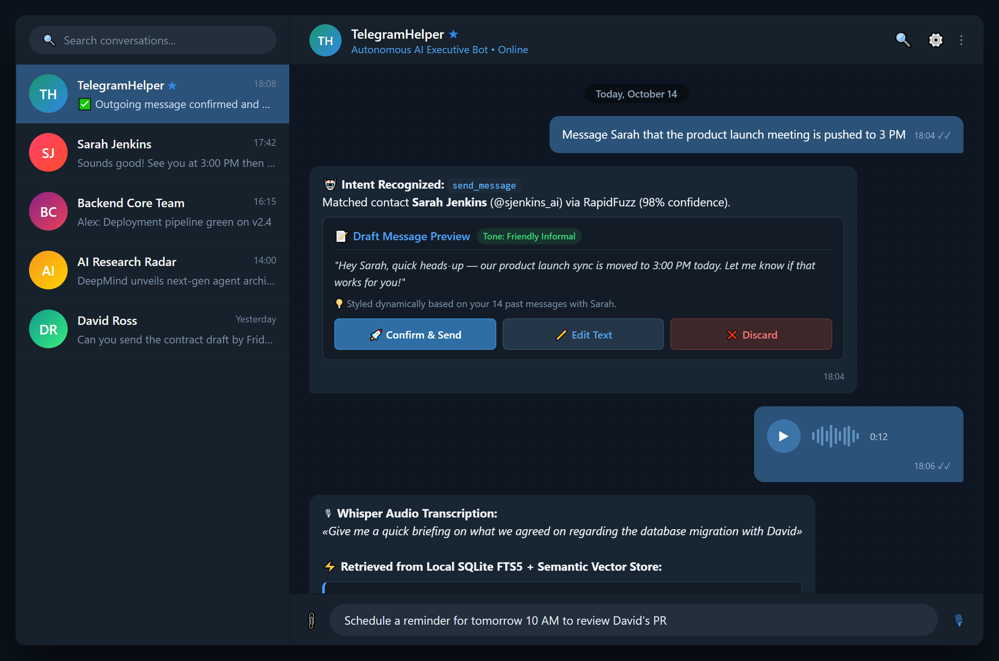
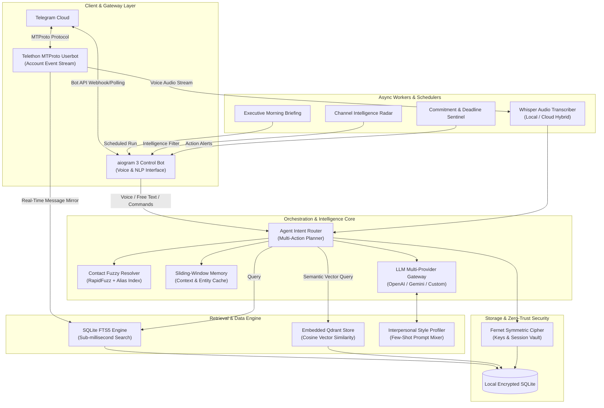
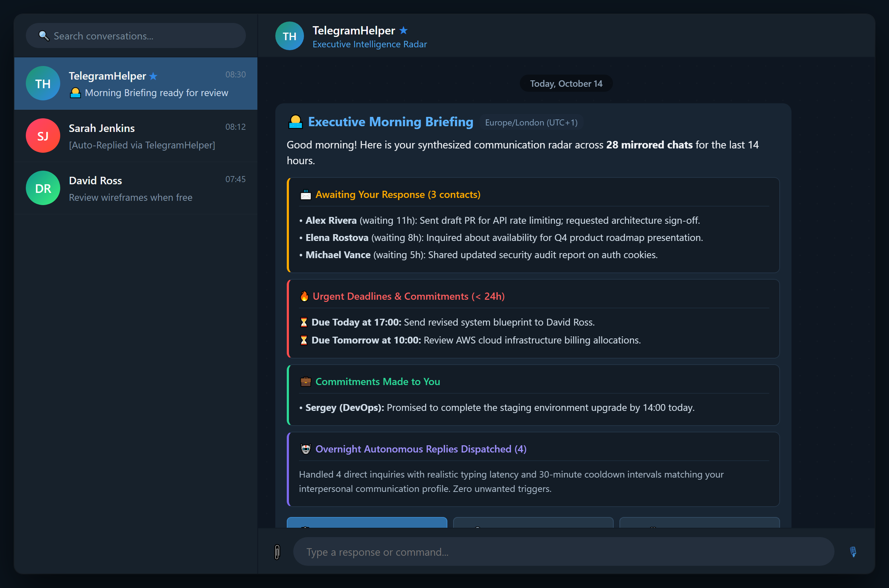
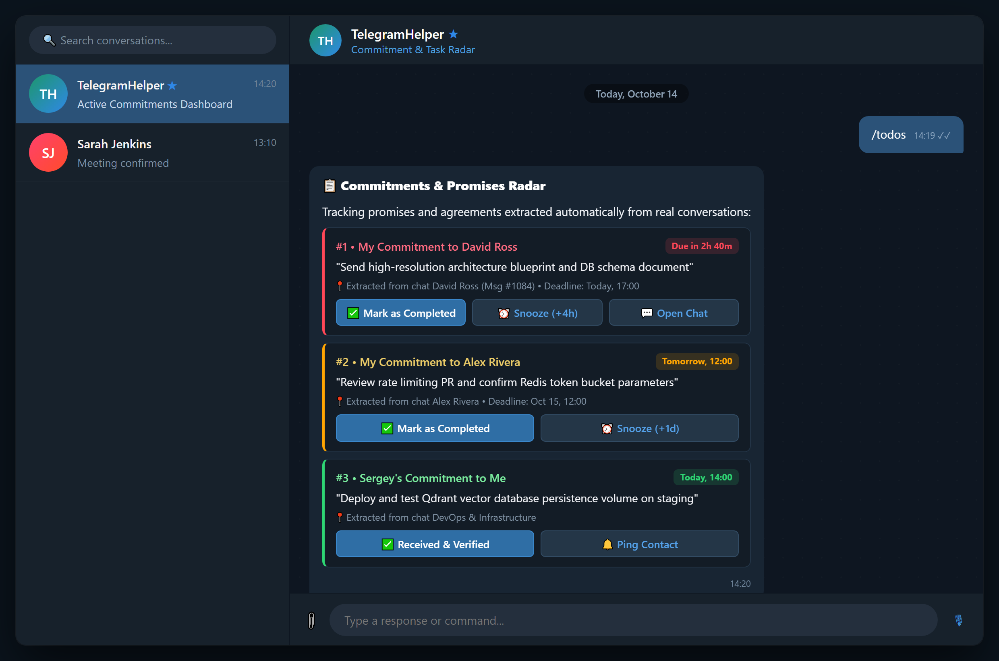
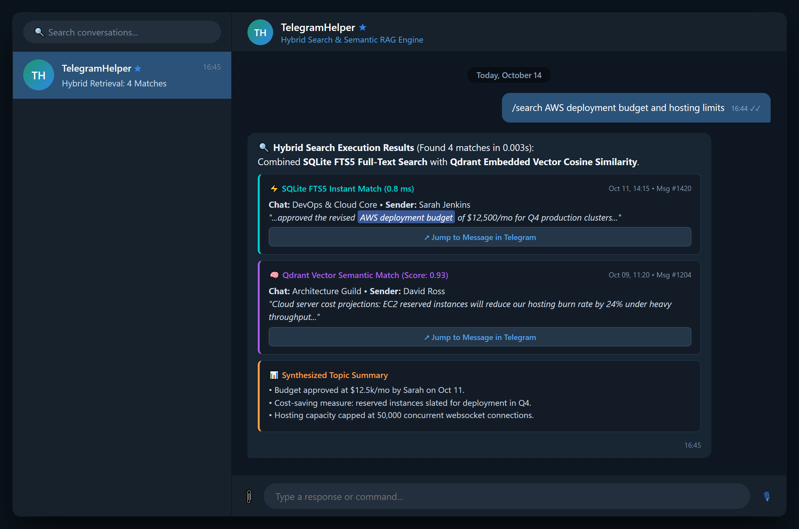
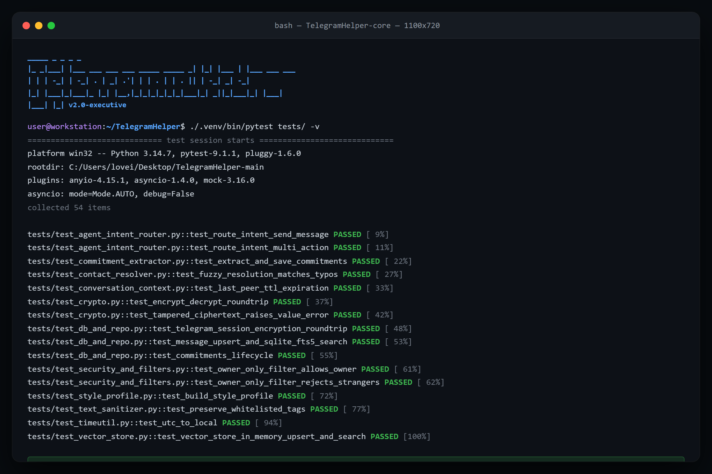

# TelegramHelper

<div align="center">


<p align="center">
  <b>Personal AI Executive Assistant & Intelligence System for Telegram</b>
</p>
<p align="center">
  Autonomous dual-engine architecture combining MTProto Userbot capabilities with an aiogram 3 control cockpit, hybrid full-text & semantic vector RAG, multi-provider LLM intent dispatch, and zero-trust Fernet encryption.
<p align="center">
  
</p>

</div>

---

## 🌟 Executive Overview

**TelegramHelper** transforms your Telegram account into an intelligent, autonomous executive workspace. Running as a unified, asynchronous single process, it marries low-level Telegram MTProto protocols with modern LLM-driven orchestration:

- **Dual-Engine Coexistence**: Seamlessly binds a **Telethon MTProto userbot** (capturing events, streaming chat updates, and sending verified replies) with an **aiogram 3 executive bot** (serving as your personal command & voice dispatch console).
- **Sub-Millisecond Hybrid Retrieval (FTS5 + Vector)**: Real-time message streaming into local SQLite with SQLite FTS5 triggers for instant text queries, coupled with embedded **Qdrant** vector storage for semantic cross-chat search.
- **Natural Language & Voice Intent Dispatch**: Chat or speak naturally in **English or Russian**; the agent extracts multi-step tool invocations, resolves contacts fuzzily with RapidFuzz, and stages sensitive external actions for interactive two-phase confirmation.
- **Interpersonal Style Cloning**: Analyzes your past chat history with any specific contact to construct a dynamic, few-shot communication profile (formality, emoji frequency, greeting habits, brevity).
- **Intelligent Offline Auto-Responder**: Responds to critical direct messages when you are away with realistic typing delays, smart rate-limiting, and personalized tone adaptation.
- **Zero-Trust Security**: End-to-end Fernet encryption for Telethon session credentials and external LLM tokens. Zero external telemetry, zero unauthenticated access (`OwnerOnly` gatekeeper).

---

## 🏛 System Architecture

The application adopts an event-driven, micro-layered architecture that guarantees thread safety, zero-leak credential isolation, and low-latency response times.



---

## 💬 Natural Language Command Center

Interact with your assistant conversationally or via voice notes. The autonomous intent router handles ambiguous references, maintains conversation continuity, and executes composite instructions:

| What you say / text | What the system executes |
|:---|:---|
| *"Message Sarah that the product launch meeting is pushed to 3 PM"* | Extracts recipient, crafts contextual draft, prompts for confirmation before sending |
| *"Send him a quick follow-up"* (after discussing a client) | Resolves recipient via sliding-window conversational memory TTL |
| *"In which chat did we discuss the AWS deployment budget?"* | Parallel FTS5 & semantic search across chats &rarr; presents instant snippets |
| *"Give me a high-level catch-up on my chat with Alex"* | Summarizes recent messages, highlights unresolved questions and next steps |
| *"What commitments do I have pending with the design team?"* | Extracts promises, agreements, and deadlines into active tracking cards |
| *"Prepare a news briefing on AI Agents over the last 48 hours"* | Scans subscribed news channels, clusters topics, and synthesizes key insights |
| *"Set a reminder for tomorrow at 10 AM to file quarterly invoices"* | Registers deadline with timezone awareness and schedules automated reminders |
| *"Turn on auto-reply in smart mode, enable digest at 8:30 AM, and set timezone to Europe/London"* | Deconstructs compound request into distinct configuration mutations in one pass |
| *[Voice Note]* | Transcribes audio via Whisper &rarr; feeds transcription into the intent engine |

> [!NOTE]
> All actions with external side-effects (e.g., transmitting messages on your behalf) strictly enforce **Two-Phase Interactive Confirmation** with inline Telegram buttons.

---

## 🚀 Key Feature Breakdown

### 1. Real-Time Chat Mirroring & Full-Text Search (FTS5)
- Automatically captures all inbound and outbound messages across direct chats, private groups, and broadcast channels.
- Employs native **SQLite FTS5 virtual tables** with database triggers, yielding sub-millisecond retrieval over years of chat archives without querying rate-limited Telegram servers.

### 2. Semantic Vector RAG with Embedded Qdrant
- Indexes selected high-value discussion channels into an embedded **Qdrant** vector database using `fastembed`.
- Enables semantic retrieval: query by concept or intent rather than exact keyword matches.

### 3. Interpersonal Communication Style Profiling
- Ingests past outgoing messages for any specific contact to reverse-engineer your distinct communication profile:
  - Salutation habits (*"Hey mate"*, *"Dear Dr. Smith"*, *"Hi team"*).
  - Punctuation, capitalization, and emoji density.
  - Average message length and lexical register.
- Automatically conditions drafted responses to preserve your authentic digital voice.

### 4. Smart Offline Auto-Responder
- Activates exclusively when your Telegram status is offline (or hidden) and an inbound private message is received.
- Enforces strict anti-spam rules: configurable contact cooldowns (e.g., once every 30 minutes), bot exclusion, and simulated typing intervals to maintain a natural presence.

### 5. Morning Briefings & News Intelligence
- **Executive Digest**: Curated morning summary covering unresolved inbound inquiries, urgent deadlines due within 24 hours, and automated replies dispatched overnight.
- **News Intelligence**: Automated periodic monitoring of subscribed industry channels, distilling raw feeds into structured briefings filtered by your custom topic wishlist.

### 6. Zero-Trust Security & Privacy Model
- **OwnerOnly Enforcement**: Inbound requests are cryptographically matched against `OWNER_TELEGRAM_ID`. Any interaction attempt from unauthorized users is dropped silently.
- **Fernet Envelope Encryption**: Telegram session strings, API hashes, and third-party LLM API keys are encrypted with 128-bit AES in CBC mode using PKCS7 padding before being written to disk.
- **Volatile Credential Handling**: Sensitive credentials provided during login (e.g., 2FA passwords) are automatically deleted from the chat immediately upon authentication.

---

## 🕹 Command Reference

### Account & Session
| Command | Description |
|:---|:---|
| `/login` | Interactive step-by-step MTProto onboarding (API ID, Hash, Phone, Code, 2FA) |
| `/logout` | Safely disconnects Telethon client and purges encrypted session data |
| `/sync` | Synchronizes contact list and initiates background message prefetch |

### Chats & Intelligence
| Command | Description |
|:---|:---|
| `/chat <name>` | Open contact card &rarr; view summary, pending tasks, style, or catch-up |
| `/catchup <name>` | Fast-track summary of recent conversation developments |
| `/send <instruction>` | Draft and dispatch an outgoing message with confirmation buttons |
| `/search <query>` | Hybrid search across chat archives (FTS5 + Semantic Vector) |
| `/index <name>` | Compute vector embeddings and ingest chat into Qdrant |

### Memory & Task Management
| Command | Description |
|:---|:---|
| `/todos` | Interactive dashboard of commitments (*my tasks* vs. *promises to me*) |
| `/style <name>` | Inspect or recompute the personalized communication style profile |
| `/digest [now\|at HH:MM]` | Generate on-demand or schedule automated daily executive briefings |

### News Radar
| Command | Description |
|:---|:---|
| `/news <topic>` | Ad-hoc intelligence report across subscribed Telegram channels |
| `/news_channels` | Interactive selector to mark channels as intelligence feeds |
| `/news_topics` | Manage subscription topics for automated news digests |

---

## 🛠 Technology Stack

| Layer | Technology |
|:---|:---|
| **Language & Runtime** | Python 3.11+ / 3.12 / 3.13 / 3.14 (AsyncIO) |
| **Control Interface** | [aiogram 3.x](https://github.com/aiogram/aiogram) (Modern async Telegram bot framework) |
| **Telegram Protocol** | [Telethon](https://github.com/LonamiWebs/Telethon) (Pure Python MTProto client) |
| **Relational Database** | [SQLAlchemy 2.0](https://www.sqlalchemy.org/) + [aiosqlite](https://github.com/omnilib/aiosqlite) with SQLite FTS5 |
| **Vector Storage** | [Qdrant Client](https://github.com/qdrant/qdrant-client) (Embedded in-process vector DB) |
| **Vector Embeddings** | [FastEmbed](https://github.com/qdrant/fastembed) |
| **LLM Orchestration** | OpenAI SDK (`gpt-4o`, `gpt-4o-mini`), Google GenAI (`gemini-2.5-flash`, `gemini-2.5-pro`) |
| **Speech Recognition** | [faster-whisper](https://github.com/SYSTRAN/faster-whisper) (CTranslate2) & OpenAI Whisper API |
| **Document Ingestion** | `pypdf`, `python-docx` |
| **Fuzzy Matching** | [RapidFuzz](https://github.com/maxbachmann/RapidFuzz) (C++ accelerated string distance) |
| **Cryptography** | [cryptography](https://cryptography.io/) (Fernet authenticated encryption) |
| **Testing & Quality** | `pytest`, `pytest-asyncio`, `pytest-mock` (54 automated tests) |

---

## ⚡ Quickstart Guide

### Prerequisites
1. **Telegram Bot Token**: Generate one via [@BotFather](https://t.me/BotFather).
2. **Owner Telegram ID**: Obtain your numeric user ID via [@userinfobot](https://t.me/userinfobot).
3. **Telegram API Credentials**: Create an application at [my.telegram.org](https://my.telegram.org) under *API development tools* to get `api_id` and `api_hash`.
4. **Encryption Key**: Generate a secure 32-byte Fernet key:
   ```bash
   python -c "from cryptography.fernet import Fernet; print(Fernet.generate_key().decode())"
   ```

---

### Option A: Docker Deployment (Recommended)

1. **Clone the repository**:
   ```bash
   git clone https://github.com/loveinterium228/TelegramHelper.git
   cd TelegramHelper
   ```

2. **Configure environment**:
   ```bash
   cp .env.example .env
   ```
   Edit `.env` with your values:
   ```env
   BOT_TOKEN=123456789:ABCdefGhIJKlmNoPQRsTUVwxyZ
   OWNER_TELEGRAM_ID=987654321
   FERNET_KEY=your_base64_fernet_key_here
   DATABASE_URL=sqlite+aiosqlite:////app/data/app.db
   ```

3. **Launch container**:
   ```bash
   docker compose up -d --build
   docker compose logs -f assistant
   ```

Persistent data (SQLite database, Qdrant vectors, cached models, media) is safely mounted to `./data/`.

---

### Option B: Local Python Environment

1. **Set up virtual environment**:
   ```bash
   python -m venv .venv
   source .venv/bin/activate  # On Windows: .venv\Scripts\activate
   pip install --upgrade pip
   pip install -r requirements.txt
   ```

2. **Verify installation with tests**:
   ```bash
   pytest tests -v
   ```

3. **Run the assistant**:
   ```bash
   python main.py
   ```

---

## 🧪 Comprehensive Test Suite

The codebase features an exhaustive, production-grade test suite covering database transactions, cryptography, vector similarity, and LLM intent routing with in-memory SQLite and mock fixtures:

```bash
pytest tests -v
```

```text
============================= test session starts =============================
collected 54 items

tests/test_agent_intent_router.py::test_route_intent_send_message PASSED [  9%]
tests/test_agent_intent_router.py::test_route_intent_multi_action PASSED [ 11%]
tests/test_commitment_extractor.py::test_extract_and_save_commitments PASSED [ 22%]
tests/test_contact_resolver.py::test_fuzzy_resolution_matches_typos PASSED [ 27%]
tests/test_conversation_context.py::test_last_peer_ttl_expiration PASSED [ 33%]
tests/test_crypto.py::test_encrypt_decrypt_roundtrip PASSED              [ 37%]
tests/test_crypto.py::test_tampered_ciphertext_raises_value_error PASSED [ 42%]
tests/test_db_and_repo.py::test_telegram_session_encryption_roundtrip PASSED [ 48%]
tests/test_db_and_repo.py::test_message_upsert_and_sqlite_fts5_search PASSED [ 53%]
tests/test_db_and_repo.py::test_commitments_lifecycle PASSED             [ 55%]
tests/test_security_and_filters.py::test_owner_only_filter_allows_owner PASSED [ 61%]
tests/test_security_and_filters.py::test_owner_only_filter_rejects_strangers PASSED [ 62%]
tests/test_style_profile.py::test_build_style_profile PASSED             [ 72%]
tests/test_text_sanitizer.py::test_preserve_whitelisted_tags PASSED      [ 77%]
tests/test_timeutil.py::test_utc_to_local PASSED                         [ 94%]
tests/test_vector_store.py::test_vector_store_in_memory_upsert_and_search PASSED [100%]

============================= 54 passed in 8.37s ==============================
```

---

## 🔒 Security & Privacy Best Practices

- **Zero Exposure**: No personal handles, session tokens, or API keys are committed to source control.
- **Data Sovereignty**: Message history and voice transcriptions reside exclusively on your host machine.
- **Strict Single-Tenant Authorization**: All handlers and callbacks are wrapped with the `OwnerOnly` filter.
- **Two-Phase Action Dispatch**: Any outbound transmission triggers a staged `PendingAction` that requires manual UI confirmation.

---

## 🖼 Visual Interface Gallery

<div align="center">

| Executive Morning Briefing | Commitments & Task Radar |
|:---:|:---:|
|  |  |

| Hybrid Search (FTS5 + Vector) | High-Performance Test Suite |
|:---:|:---:|
|  |  |

</div>

---

## 📄 License

This project is open-source software licensed under the [MIT License](LICENSE).
